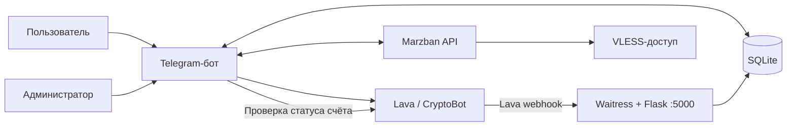

# Erebus Proxy

**Telegram-бот для продажи и управления VLESS-подписками через Marzban.**

Пользователь пополняет баланс, выбирает тариф и получает ссылку подписки. Администратор управляет тарифами, выдаёт доступ, настраивает кластеры и следит за оплатами прямо в Telegram.

Проект управляет доступом через API уже установленного Marzban. Сам прокси-сервер, Xray и панель Marzban в этот репозиторий не входят.

> [!WARNING]
> В текущем коде есть существенные риски в обработке платежей, многопоточности и проверке TLS. До приёма реальных платежей ознакомьтесь с разделом [«Недостатки и уязвимости»](#недостатки-и-уязвимости) и устраните критичные проблемы. Этот README описывает существующую реализацию; перечисленные проблемы ещё не исправлены.

## Содержание

- [Возможности](#возможности)
- [Как устроен проект](#как-устроен-проект)
- [Что понадобится](#что-понадобится)
- [Быстрый запуск](#быстрый-запуск)
- [Настройки окружения](#настройки-окружения)
- [Первичная настройка в Telegram](#первичная-настройка-в-telegram)
- [Запуск в Docker](#запуск-в-docker)
- [Данные и резервные копии](#данные-и-резервные-копии)
- [Недостатки и уязвимости](#недостатки-и-уязвимости)
- [Диагностика](#диагностика)

## Возможности

### Для пользователя

- Личный кабинет: баланс, срок действия и ссылка подписки.
- Пополнение через Lava и CryptoBot с ручной проверкой оплаты.
- Покупка и продление подписки с внутреннего рублёвого баланса.
- Подарочные подписки со ссылкой активации для другого пользователя.
- Промокоды на пополнение баланса.
- Реферальная система с начислением процента от пополнений приглашённых пользователей.
- Автоматический пробный период для новых пользователей, если он включён администратором.
- Уведомления о приближающемся окончании и завершении подписки.
- Встроенные инструкции подключения для iOS, Android, Windows и macOS.

### Для администратора

- Панель `/admin` с доступом по одному Telegram ID.
- Создание и удаление тарифов, управление продажами и способами пополнения.
- Изменение минимальной суммы пополнения, пробного периода и реферального процента.
- Выдача баланса и подписок, бессрочный доступ и отзыв подписки.
- Выдача реальной тестовой подписки на одну минуту.
- Управление промокодами.
- Получение VLESS inbound-тегов из Marzban, настройка лимитов и распределения пользователей.
- Статистика пользователей, активных подписок, пополнений и рефералов.
- Рассылка текста или фотографии.
- Экспорт таблиц в Excel и резервная копия SQLite через Backup API.
- Уведомления об оплатах в отдельный Telegram-чат или канал.

## Как устроен проект



Бот получает Telegram-сообщения через **long polling**. Отдельный HTTP-сервер принимает только платёжные уведомления Lava по `POST /webhook`. У CryptoBot в этом проекте используется кнопка проверки оплаты, отдельного webhook нет.

```text
.
├── main.py                 # запуск бота, HTTP-сервера и проверки подписок
├── loader.py               # общие экземпляры бота, БД и API-клиентов
├── config.py               # переменные окружения
├── database/db.py          # SQLite, пользователи, баланс, тарифы и подписки
├── handlers/
│   ├── user.py             # кабинет, оплаты, покупки, подарки и инструкции
│   └── admin.py            # админ-панель, рассылки и экспорт
├── services/
│   ├── marzban.py          # управление VLESS-пользователями
│   ├── cryptobot.py        # создание и проверка Crypto Pay-счетов
│   ├── lava.py             # запросы к Lava Business API
│   └── server.py           # Flask webhook под Waitress
├── utils/
│   ├── keyboards.py        # Telegram-клавиатуры
│   └── notifications.py    # уведомления об оплатах
├── .env.example            # шаблон настроек
├── requirements.txt        # зависимости
└── Dockerfile              # образ приложения на Python 3.10
```

Кластеры в терминах этого бота — записи с inbound-тегом Marzban и локальным счётчиком пользователей. Бот не разворачивает дополнительные серверы и не измеряет их реальную нагрузку.

## Что понадобится

- Python **3.10** — эта версия используется в Dockerfile.
- Telegram-бот, созданный через [@BotFather](https://t.me/BotFather), и числовой ID администратора.
- Работающий Marzban с доступным API, настроенными VLESS inbound и совместимыми клиентскими параметрами.
- Доступ сервера к Telegram Bot API и API используемых платёжных сервисов.
- Учётные данные Lava Business и/или приложения Crypto Pay.
- Для автоматических уведомлений Lava — публичный HTTPS-адрес, направленный на HTTP-сервер приложения.

Docker устанавливает только приложение и его Python-зависимости. Marzban, домен, TLS-сертификат и обратный прокси настраиваются отдельно.

## Быстрый запуск

### Linux / macOS

```bash
git clone https://github.com/ankapi69/erebus_proxy.git
cd erebus_proxy
python3.10 -m venv .venv
source .venv/bin/activate
python -m pip install -r requirements.txt
cp .env.example .env
```

### Windows / PowerShell

```powershell
git clone https://github.com/ankapi69/erebus_proxy.git
cd erebus_proxy
py -3.10 -m venv .venv
.\.venv\Scripts\python.exe -m pip install -r requirements.txt
Copy-Item .env.example .env
```

Заполните `.env` перед запуском. Не оставляйте `ADMIN_ID` пустым: значение преобразуется в число при импорте конфигурации.

Минимальный пример для настройки бота и Marzban:

```dotenv
BOT_TOKEN=replace_with_botfather_token
ADMIN_ID=123456789
MARZBAN_URL=https://panel.example.com
MARZBAN_LOGIN=replace_with_admin_login
MARZBAN_PASSWORD=replace_with_admin_password
SUPPORT_USERNAME=your_support_username
```

Скопируйте в `.env` также параметры выбранной платёжной системы из следующего раздела. Значения выше — заполнители, а не рабочие реквизиты.

Запуск на Linux / macOS из активированного окружения:

```bash
python main.py
```

Запуск на Windows:

```powershell
.\.venv\Scripts\python.exe main.py
```

База и таблицы создаются автоматически. При работе в терминале используйте `Ctrl+C` для остановки. Для постоянной работы нужны сервер и управление процессом, например Docker с политикой перезапуска.

## Настройки окружения

| Переменная | Назначение |
| --- | --- |
| `BOT_TOKEN` | Токен Telegram-бота. Обязателен. |
| `ADMIN_ID` | Числовой Telegram ID единственного администратора. Обязателен для доступа к панели. |
| `BOT_USERNAME` | Имя бота без `@`. Необязательный резервный вариант; при успешном запуске определяется через `get_me()`. |
| `MARZBAN_URL` | Базовый URL панели, например `https://panel.example.com`, без `/api` в конце. |
| `MARZBAN_LOGIN` | Логин администратора Marzban. |
| `MARZBAN_PASSWORD` | Пароль администратора Marzban. |
| `CRYPTO_BOT_TOKEN` | Токен приложения Crypto Pay. Счёт создаётся в RUB, оплата предлагается в поддерживаемых криптовалютах. |
| `LAVA_PROJECT_ID` | Идентификатор проекта/магазина Lava. |
| `LAVA_SECRET_KEY` | Основной ключ для подписи запросов к Lava API. |
| `LAVA_ADDITIONAL_KEY` | Дополнительный ключ для проверки входящих уведомлений Lava. |
| `BASE_URL` | Публичный HTTPS-адрес приложения; к нему добавляется `/webhook`. Замените адрес из шаблона своим. |
| `POSTBACK_CHAT_ID` | Необязательный ID чата/канала уведомлений об оплатах, например `-1001234567890`. Боту нужны права отправки сообщений. |
| `SUPPORT_USERNAME` | Telegram-имя поддержки без `@`. Значение по умолчанию — `ankapi69`. |

**Путь к базе не задаётся через `.env`:** `Config.DB_PATH` жёстко установлен в `vpn_bot.db`. Файл создаётся относительно рабочей директории процесса. Внутренний HTTP-сервер всегда слушает `0.0.0.0:5000`; отдельных переменных `HOST` и `PORT` нет.

Для Lava итоговый адрес уведомлений имеет вид:

```text
https://bot.example.com/webhook
```

Настройте обратный прокси так, чтобы этот путь передавался на порт `5000`. Telegram-сообщения при этом продолжат поступать через polling — адрес `BASE_URL` не является Telegram webhook.

## Первичная настройка в Telegram

1. Откройте бота и отправьте `/start`.
2. С аккаунта, указанного в `ADMIN_ID`, откройте `/admin`.
3. Перейдите в **«Кластеры» → «Обновить из Marzban»**.
4. Откройте нужные inbound-теги, установите лимиты и включите их. Новые записи после синхронизации создаются **выключенными**, с лимитом `10` пользователей.
5. Выберите автоматическое распределение либо ручной выбор кластера для продаж.
6. Проверьте тарифы, минимальное пополнение, реферальный процент и пробный период.
7. В **«Управлении продажами»** отключите неиспользуемые способы пополнения.

При новой базе создаются тарифы **7 дней / 50 ₽**, **30 дней / 150 ₽**, **90 дней / 400 ₽**. Минимальное пополнение — **10 ₽**, реферальное вознаграждение — **20%**, автоматический триал выключен. Параметры меняются в админ-панели и сохраняются в SQLite.

Сроки `30`, `90` и `365` в расчёте подписки означают календарный месяц, три месяца и год соответственно. Другие значения прибавляются как количество дней.

> **О тестировании:** административная кнопка «Тест 1 мин» создаёт реальный доступ в Marzban. Режима симуляции платежей, отдельного тестового баланса и переключателя Crypto Pay testnet в этом репозитории нет. Для проверки используйте отдельного бота и тестовый экземпляр Marzban; не путайте эту кнопку с безопасным платёжным симулятором.

## Запуск в Docker

До сборки создайте в корне проекта `.dockerignore` как минимум с таким содержимым:

```dockerignore
.env
.env.*
!.env.example
.git
.venv
__pycache__
*.db*
*.sqlite*
*.backup
```

Это необходимо, поскольку существующий Dockerfile использует `COPY . .`: без исключений секреты и локальные данные могут попасть в образ. В исходном репозитории `.dockerignore` отсутствует.

Следующий пример рассчитан на Linux-сервер. После заполнения `.env`:

```bash
docker build -t erebus-proxy .
docker volume create erebus-proxy-data
docker run -d \
  --name erebus-proxy \
  --restart unless-stopped \
  --env-file .env \
  --mount source=erebus-proxy-data,target=/data \
  --workdir /data \
  -e TZ=UTC \
  -p 127.0.0.1:5000:5000 \
  erebus-proxy python /app/main.py
```

Здесь код запускается из `/app`, а относительный файл `vpn_bot.db` и его WAL/SHM размещаются в постоянном томе `/data`. Новая пустая область данных не импортирует существующую базу автоматически. Не удаляйте том, если хотите сохранить пользователей и баланс.

Порт публикуется только на localhost хоста: предполагается HTTPS-прокси на том же сервере. Если прокси находится в другом контейнере, настройте общую Docker-сеть и адрес приложения в этой сети.

```bash
docker logs -f erebus-proxy
docker stop erebus-proxy
docker start erebus-proxy
```

Один токен бота должен обслуживаться одним экземпляром polling-процесса.

## Данные и резервные копии

SQLite хранит пользователей, баланс, сроки подписок, тарифы, промокоды, подарки, оплаченные счета, настройки и кластеры. Используется режим WAL, поэтому рядом с основной базой могут находиться `vpn_bot.db-wal` и `vpn_bot.db-shm`.

- Для работающего приложения используйте **`/admin` → «.db файл»**: этот путь вызывает SQLite Backup API.
- Копирование только основного `.db` во время работы может пропустить изменения из WAL.
- Экспорт **Excel** удобен для просмотра, но не заменяет резервную копию для восстановления.
- Сохраняйте резервные копии вне каталога приложения и проверьте восстановление на отдельном экземпляре.
- Ограничивайте доступ к экспортам: они содержат Telegram ID, баланс и данные подписок.

## Недостатки и уязвимости

Ниже — отдельный обзор текущих исходников, а не список уже выполненных исправлений. Проверка статическая: реальные платежи, панель Marzban и развёрнутая инфраструктура не тестировались. Уровни важности — оценка последствий по коду; наличие CVE у зависимостей отдельно не проверялось.

### Уязвимости и риски безопасности

| Важность | Что обнаружено | Последствие и необходимое исправление |
| --- | --- | --- |
| **Критичная** | В [`handlers/user.py`](handlers/user.py) обработчики `check_lava_handler` и `check_crypto_handler` берут сумму из `call.data`, а `_process_payment` зачисляет её пользователю, нажавшему кнопку. Провайдеры возвращают только признак оплаты; ожидаемая сумма и владелец созданного счёта не сохраняются и не сверяются. | Изменённые данные callback могут привести к зачислению неверной суммы или оплате на чужой баланс. Нужна серверная запись счёта до оплаты, проверка владельца, суммы, валюты, провайдера и статуса по ответу API. Данным кнопок доверять нельзя. |
| **Высокая** | В [`services/marzban.py`](services/marzban.py) запросы выполняются с `verify=False`, предупреждения о небезопасном TLS отключены. | При возможности подмены сетевого соединения можно перехватить пароль/токен панели или подменить ответы. Нужны проверка сертификата, доверенная цепочка CA и HTTPS. |
| **Высокая, при работе в группе** | В [`handlers/admin.py`](handlers/admin.py) у ряда следующих шагов, включая `give_balance_final`, `process_change_trial` и `process_add_tariff_price`, нет повторной проверки `ADMIN_ID`. Сценарии не ограничены личным чатом. | Следующее сообщение в общем чате может поступить от другого участника и завершить административное действие. Проверяйте автора на каждом шаге, связывайте состояние с пользователем и ограничивайте админские сценарии личными чатами. Привязка next-step к чату описана в [документации pyTelegramBotAPI](https://pytba.readthedocs.io/en/4.25.0/sync_version/index.html#telebot.TeleBot.register_next_step_handler). |
| **Высокая** | В Git отслеживаются `vpn_bot.db-wal` и `vpn_bot.db-shm`, несмотря на соответствующие правила в `.gitignore`. | Артефакты SQLite могут содержать данные приложения и попадать в клоны/образы. Содержимое этих файлов на наличие личных данных здесь не исследовалось. Следует убрать их из отслеживания и оценить необходимость очистки истории; одно изменение `.gitignore` уже отслеживаемые файлы не удаляет. |
| **Высокая, при сборке с секретами** | В [`Dockerfile`](Dockerfile) есть `COPY . .`, а `.dockerignore` отсутствует. | Если перед сборкой рядом лежит `.env` или база, они могут попасть в образ. Добавьте исключения до сборки, ограничьте состав копируемых файлов; если секреты уже распространялись в образах, замените их. |
| **Средняя** | В [`handlers/user.py`](handlers/user.py) код подарка использует только первые восемь hex-символов UUID. Ограничения частоты попыток активации нет. | Пространство кодов ограничено 32 битами, возможны коллизии и попытки подбора. Нужны длинные криптографически случайные коды, обработка коллизий и ограничение частоты запросов. |
| **Средняя** | В [`services/server.py`](services/server.py) webhook не сверяет платёж с заранее сохранённым счётом, а ошибки начисления внутри обработчика могут завершаться HTTP `200`. | Подпись реализована, но не заменяет проверку реквизитов счёта; при внутреннем сбое уведомление может считаться принятым без начисления. Нужны надёжная обработка события, валидация данных и повторяемая процедура зачисления. |

### Недостатки реализации и надёжности

| Проблема | Где и как проявляется | Что улучшить |
| --- | --- | --- |
| **Общий SQLite-курсор между потоками** | [`database/db.py`](database/db.py) создаёт одно соединение и один курсор с `check_same_thread=False`. Ими пользуются обработчики Telegram, Waitress и фоновая проверка. Сам по себе WAL это не исправляет. | Разделить соединения по потокам/запросам или сериализовать операции. Исключить пересечение курсоров и чужих транзакций. |
| **Неатомарное зачисление платежа** | `check_and_mark_invoice` фиксирует счёт отдельно от изменения баланса и реферальной выплаты. Если процесс прервётся между действиями, повторная обработка увидит уже отмеченный счёт. | Выполнять запись платежа, начисление и реферальную операцию в одной транзакции; предусмотреть сверку незавершённых операций. |
| **Гонки покупок, подарков и промокодов** | Проверка баланса, списание, проверка лимита промокода и активация подарка выполняются отдельными действиями. `activate_gift` обновляет запись без условия `is_activated = 0`. | Использовать условные атомарные обновления и транзакции; проверять число изменённых строк. |
| **Рассинхронизация SQLite и Marzban** | Покупка и триал сначала меняют локальные данные, а затем вызывают `marzban.add_days`; результат вызова не проверяется. Проверка истёкших подписок также не проверяет успешность удаления пользователя. | Обрабатывать ошибки API, хранить состояние выдачи/отзыва, повторять незавершённые операции и сообщать пользователю фактический результат. |
| **Бессрочная подписка может разойтись между системами** | `Database.add_subscription` сохраняет бессрочность при добавлении дней, а `MarzbanService.add_days` может заменить `expire=0` конкретной датой. | Согласовать правила продления бессрочных подписок в обеих системах. |
| **Распределение кластеров не резервирует место атомарно** | Выбор inbound и увеличение `users_count` разделены. Счётчики локальные; ручной режим не проверяет активность и заполненность выбранного кластера. | Резервировать место одной операцией и сверять состояние с Marzban. |
| **Нет таймаутов у части HTTP-запросов** | [`services/cryptobot.py`](services/cryptobot.py), [`services/lava.py`](services/lava.py) и часть вызовов Marzban могут ждать ответа без ограничения. | Добавить таймауты подключения/чтения и контролируемые повторы, чтобы не занимать рабочие потоки бесконечно. |
| **Проверка подписок с задержкой** | [`main.py`](main.py) сначала ждёт четыре часа и только затем выполняет проверку. Уведомление отмечается до отправки; при неудачном удалении из Marzban повторный отзыв не гарантирован. | Отделить уведомление от удаления, сохранять результат и повторять ошибки. Учитывать, что минутный тест не освобождает локальное место немедленно. |
| **Ограничения валидации и учёта денег** | Быстрые суммы обходят проверку `min_topup` из ручного ввода; у части callback и админских чисел нет единых границ. Lava использует `float`, а путь ручной проверки — `int`. | Ввести общую валидацию и единый денежный формат, например целые копейки или `Decimal`. |
| **Неоднозначные идентификаторы и время** | Lava `order_id` зависит от пользователя и секундного timestamp, поэтому два счёта за секунду могут совпасть. Даты подписки выводятся с ручным прибавлением трёх часов. | Использовать уникальные идентификаторы счетов и явные часовые пояса. |
| **Нет инфраструктуры проверки** | В репозитории нет автоматических тестов и CI; версия `waitress` не зафиксирована. Рассылка не обрабатывает ограничения Telegram с повторной доставкой. | Добавить тесты платежей/гонок, проверку зависимостей, воспроизводимые версии и очередь рассылок. |
| **Настройки частично зашиты в код** | Ссылки возврата Lava и информационные ссылки находятся в исходниках; конфигурация не проверяет обязательные поля до создания сервисов. Контейнер запускается от root. | Вынести параметры в конфигурацию, добавить проверку при старте и пользователя контейнера без привилегий. |

**Приоритет доработок:** сначала доверие к платежам и проверка TLS, затем права администратора, атомарность операций и изоляция доступа к БД. После этого — согласованность с Marzban, защита подарков, резервное копирование и автоматические проверки.

## Диагностика

| Симптом | Что проверить |
| --- | --- |
| Ошибка преобразования `ADMIN_ID` | В `.env` должно быть целое число, а не пустая строка или `@username`. |
| Бот не отвечает | Корректность токена, доступ к Telegram API, журнал процесса и отсутствие второго polling-экземпляра с тем же токеном. |
| Админ-панель не открывается | Соответствие `ADMIN_ID` аккаунту отправителя; отправьте `/admin` в личном чате. |
| «Нет свободных серверов» | Выполните синхронизацию кластеров, включите нужный inbound и проверьте лимиты. |
| Подписка есть в кабинете, но не работает | Наличие пользователя `user_<telegram_id>` в Marzban, его inbound, срок и ошибки API. Локальный статус сам по себе не доказывает выдачу. |
| Lava не зачисляет платёж | Доступность `BASE_URL/webhook`, настройки ключей и магазина, журнал проверки подписи и наличие счёта в API провайдера. |
| CryptoBot не создаёт счёт | Токен приложения Crypto Pay и ответ API. Реализация использует основной API, не testnet. |
| Данные исчезают после пересоздания контейнера | Рабочую директорию процесса и постоянный том, в котором находятся `.db`, WAL и SHM. |

Перед публикацией собственного экземпляра замените ссылки возврата Lava в `services/lava.py`, информационные ссылки в `utils/keyboards.py` и адрес поддержки на свои.
